# ToothAssist CV

A working browser dental imaging workspace inspired by the five supplied desktop designs. Includes patient management, local image processing, manual findings, an interactive FDI dental chart, treatment scheduling, and patient reports.

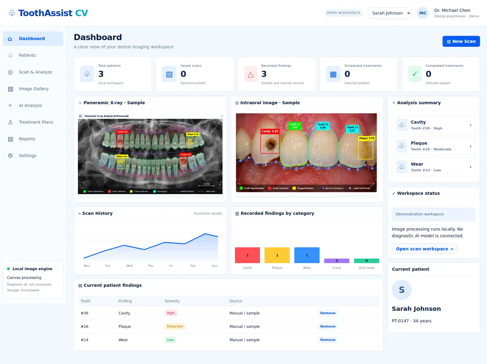

## Run

Requires Node.js 22+ for tests and Python 3 for the local server. No npm dependencies or build step.

```sh
npm run dev
# Open http://127.0.0.1:5173
```

## Workflows

- **Dashboard:** real record counts, patient findings, sample panoramic/intraoral panels, and a clearly labeled illustrative scan trend.
- **Patients:** create a patient, search name/ID, and switch the active workspace. Findings, scans, plans, and reports are isolated by patient ID.
- **Scan & Analyze / AI Analysis:** upload PNG/JPEG/WebP; use original, grayscale, Sobel edge, or binary threshold views; adjust contrast; zoom/reset; measure two points in uncalibrated image pixels. Camera capture works on localhost/HTTPS after permission.
- **Findings:** enter tooth number, category, severity, and notes; remove records; export JSON annotations. Optional boxes are schematic record markers, not image-localized detections. Reference-image annotations are already baked into the supplied sample pixels.
- **Treatment Plans:** select an FDI tooth, enter a treatment/date, and update Planned/Scheduled/Completed status. Timeline and dashboard counts update with your records.
- **Reports:** generate a report-history record, export CSV/JSON, or Print / Save as PDF through the browser print dialog.
- **Gallery:** browse all supplied design references.
- **Settings:** export/restore validated workspace JSON or reset the local demo after typing RESET.

Records autosave in localStorage. Uploaded image pixels remain in memory only; saved scans store metadata. Backup files do not include uploaded images. Refreshing reloads a sample image, while patient records remain. No network API, login, cloud synchronization, or backend is included.

## Running application screenshots

Captured from the implemented app by the browser test, rather than mockups. Test records are synthetic.

### Scan workspace

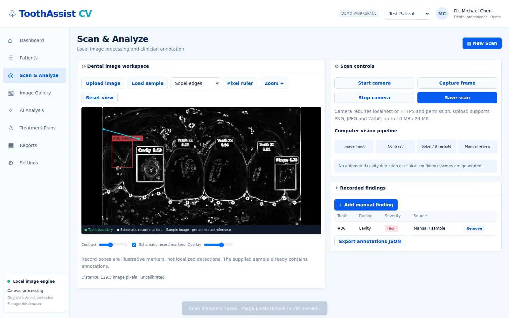

### Analysis

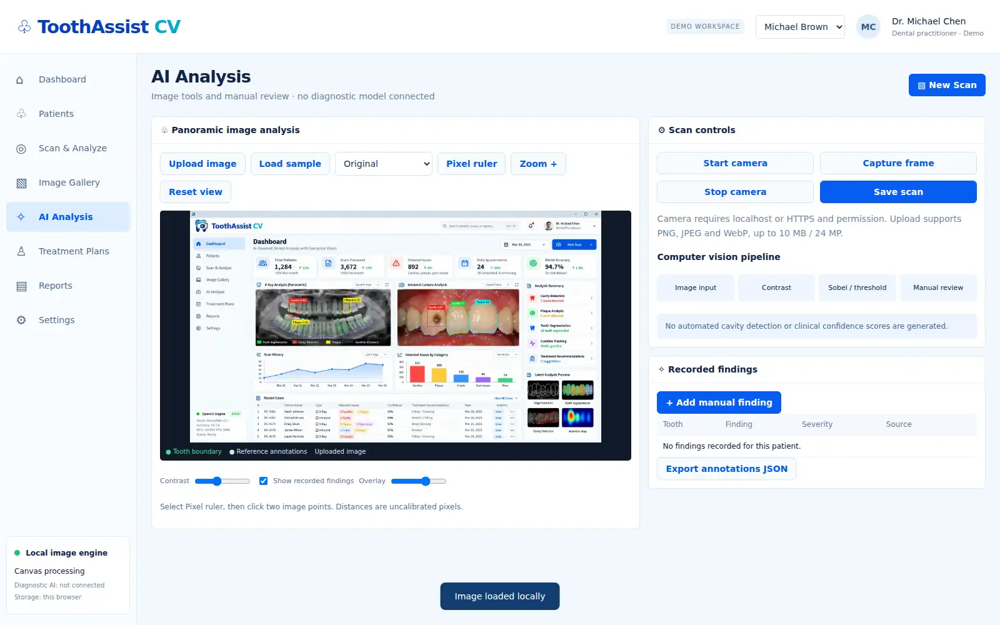

### Treatment planning

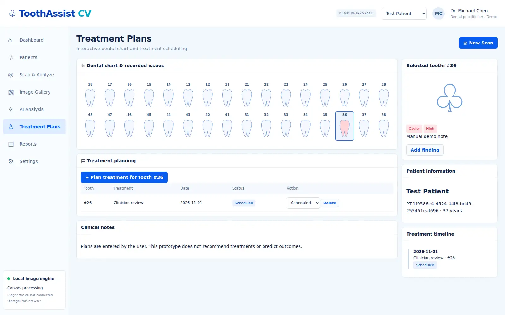

### Reports

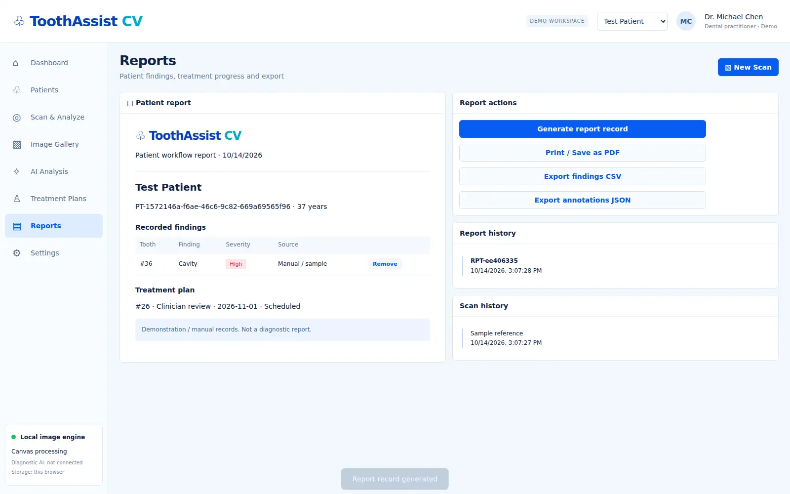

### Mobile layout

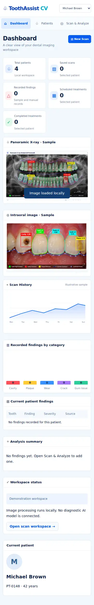

## Supplied design references

User-provided screenshots, converted to WebP for repository size. These are design references and contain illustrative data/AI annotations; they are not screenshots of this implementation.

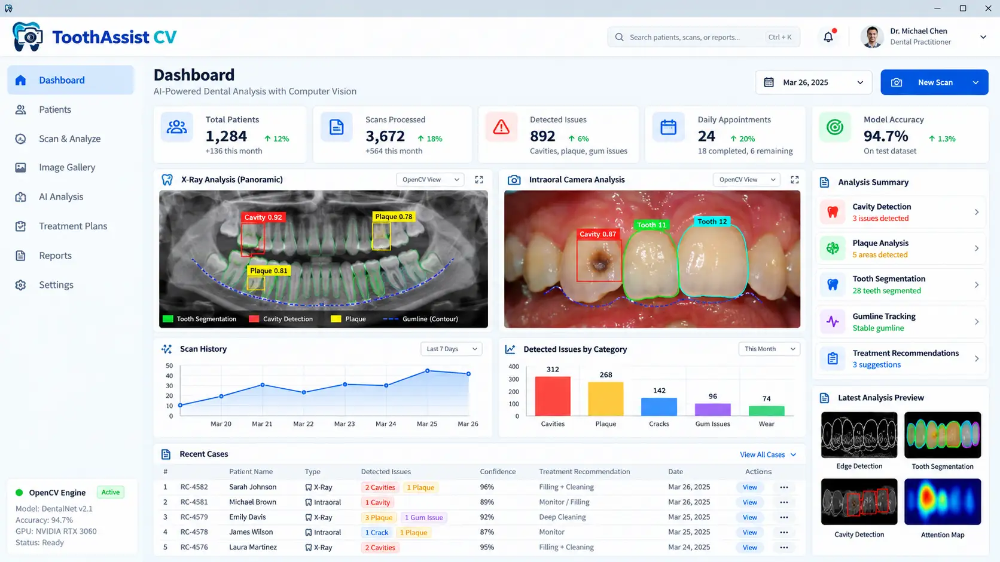
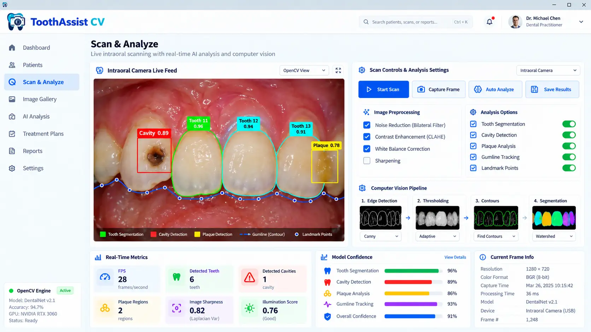
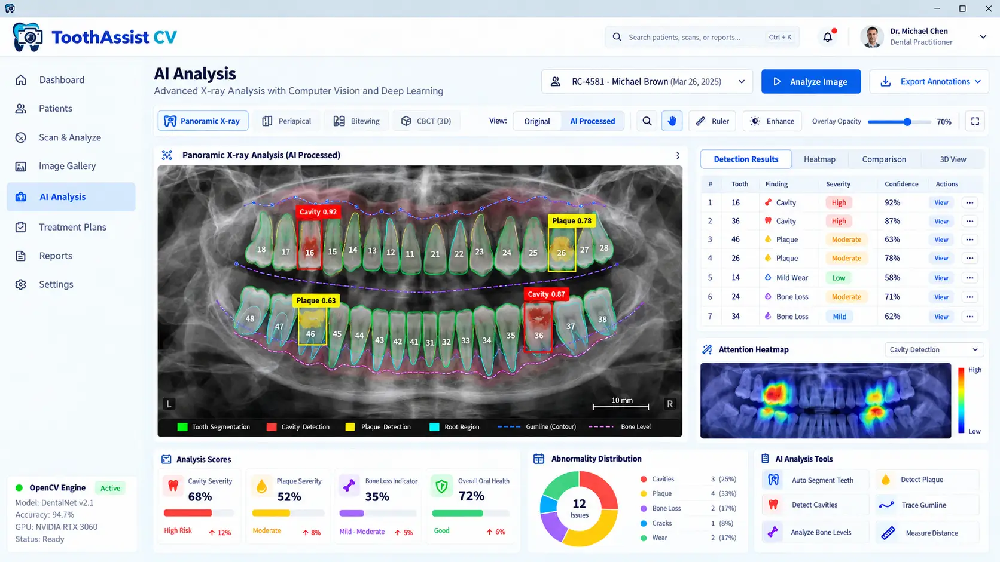
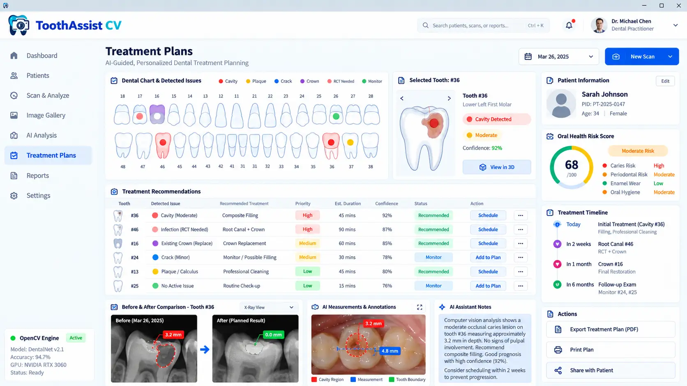
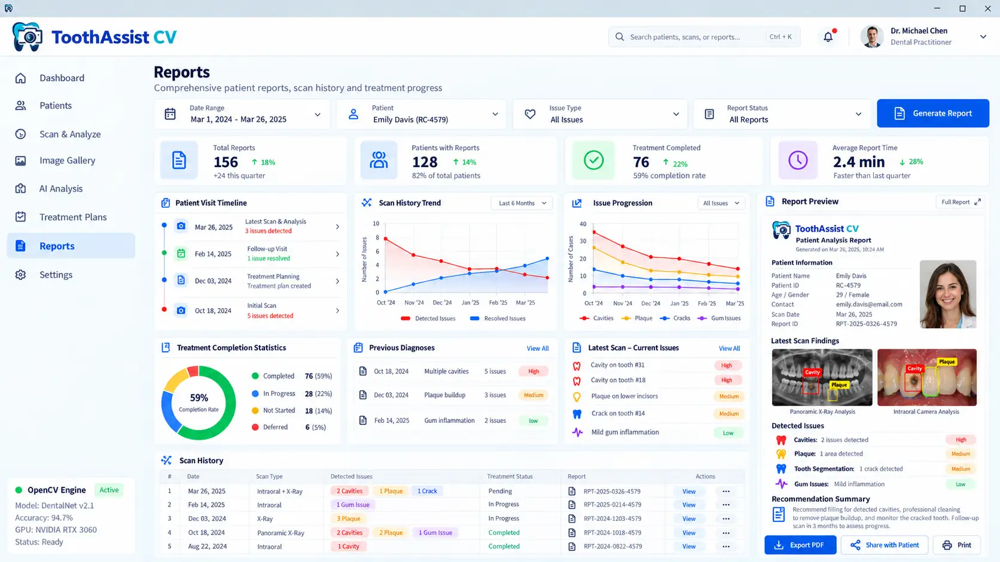

## Validation

```sh
npm run check
npm test
# Optional full browser checks; install Python Playwright and its browser:
python -m pip install playwright
python -m playwright install chromium
python tests/browser_check.py
# Or set CHROMIUM_PATH to an existing Chromium executable.
```

Eight unit tests cover patient isolation, document validation, treatment counts, JSON roundtrips, edge detection, threshold/grayscale processing, and CSV formula escaping. Browser checks cover navigation, patient creation, findings, pixel processing, ruler, scan metadata, exports, treatment state/persistence, reports, patient isolation, backup restore/rejection, image upload, and mobile overflow. Results are recorded in [browser-report.json](docs/browser-report.json). The browser test starts a local server and terminates it on exit.

## Scope

This is a demonstration software workflow, not a medical device or diagnostic engine. No trained model, OpenCV runtime, automated cavity/plaque detection, validated confidence scores, treatment recommendations, DICOM/CBCT support, clinical calibration, or 3D reconstruction is bundled. Sample imagery and findings are illustrative. Real processing consists of local Canvas pixel filters; record markers are schematic. Uploaded images support up to 10 MB and 24 megapixels; backup JSON is limited to 2 MB. Processing is synchronous and large images may briefly pause the UI. Use synthetic or de-identified data; there is no authentication, encryption of stored records, or production clinical security architecture.

## Code and history

`src/model.js` contains document validation and pixel algorithms. `src/app.js` implements workflows and Canvas rendering. `src/style.css` defines the responsive workbench. `tests/` contains unit and browser checks. `.github/workflows/checks.yml` runs syntax and unit checks.

The repository history records actual implementation stages: data/image-processing foundation, workbench and reference assets, unit validation, then verified screenshots/documentation and browser checks. Commit dates reflect when the work was performed.
